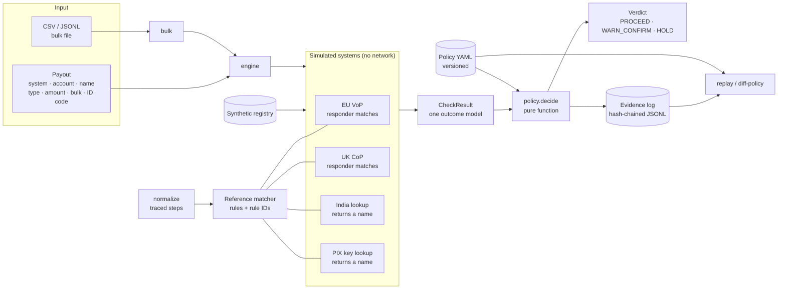
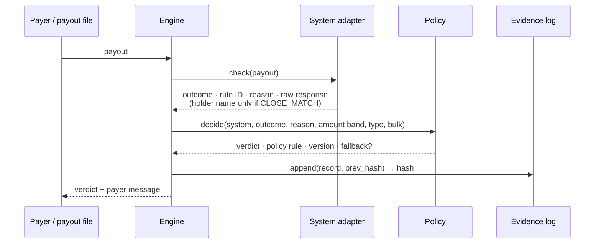

# payee-verdict

**Explainable payee-name verification across payment systems.** One proceed / warn / hold decision for a payout, whichever name-check system answers it: simulated EU Verification of Payee, UK Confirmation of Payee, India's RTGS/NEFT beneficiary-name lookup, and Brazil's PIX key lookup. Every decision carries the matcher rule that fired, a normalisation trace, the policy version, and a hash-chained evidence record that can be replayed.

[](https://github.com/karthy1004/payee-verdict/actions/workflows/ci.yml)

> [!IMPORTANT]
> **The matching rules are reference heuristics written for this project.** They are not the EPC, Pay.UK, NPCI, RBI or BCB matching rules, and this project does not claim compliance or conformance with any scheme. The four "systems" are local simulators with response shapes of my own design. No scheme specification is copied here; see [Sources](#sources). Every name, account, key and identifier is synthetic.

---

## The problem

Payers now get told, before money moves, whether the name they typed matches the account they are paying:

- **EU.** Under the Instant Payments Regulation, Verification of Payee applies in the euro area from 9 October 2025, and in non-euro member states from **9 July 2027** ([ECB](https://www.ecb.europa.eu/paym/retail/instant_payments/html/instant_payments_regulation.en.html)).
- **UK.** Confirmation of Payee is live; an extension of its scope from 31 December 2026 is under consultation (CP26/2, [summary](https://www.regulationtomorrow.com/2026/07/psr-publishes-consultation-on-specific-direction-17-confirmation-of-payee/), search summary only, needs verification).
- **India.** The RBI asked banks to offer a beneficiary-name lookup for RTGS and NEFT by 1 April 2025 ([report](https://www.business-standard.com/industry/banking/banks-to-provide-beneficiary-account-name-facility-in-neft-rtgs-by-apr-1-124123000770_1.html), search summary only, needs verification).
- **Brazil.** PIX payments are addressed by a key looked up in the central DICT directory. The details modelled here come from BCB slide decks and vendor material ([BCB Fórum Pix deck](https://www.bcb.gov.br/content/estabilidadefinanceira/pix/Forum_Pix_Plenaria/20251204-Forum_Pix.pdf), search summary) and are unverified.

The EU scheme fixes the four outcomes (match, close match, no match, not possible) but not the algorithm, so answers vary by bank. A FAQ from Convera gives "Müller GmbH" vs "MUELLER GMBH" as a pair that can come back as either a match or a close match ([Convera](https://convera.com/verification-of-payee/faq/verification-of-payee-vop), search summary). UniCredit Germany reported about 15% no-match in its own traffic ([webinar](https://gtgdownload.unicreditgroup.de/Webinar_Verification-of-Payee_20260529.pdf), search summary). That is one bank's figure, not a market statistic.

A cross-border payout platform meets all four systems at once, each with different semantics: two decide the match for you, two hand you a name and leave the matching to you, and one can tell you a key is flagged for fraud. The platform still needs one auditable answer per payout. This repository is a working model of that layer:

1. a **reference matcher** that makes its reasoning visible (what a payee's bank might run),
2. **adapters** that map four response styles onto one outcome model,
3. a **versioned policy** that turns outcome + amount + context into PROCEED / WARN_CONFIRM / HOLD, and
4. an **evidence log** that proves what was decided, under which policy, and can replay it.

## What it does: 60-second demo

```bash
git clone https://github.com/karthy1004/payee-verdict && cd payee-verdict
python -m venv .venv && . .venv/bin/activate      # Windows: .venv\Scripts\activate
python -m pip install -e ".[dev]"
python -m payee_verdict demo
```

Actual output (Windows, Python 3.13):

```text
payee-verdict 0.1.0 demo · policy payout-default@1.0.0
Synthetic registry and simulated systems; no network calls.

 # case                 system          outcome       rule                       verdict
 1 umlaut vs ue         EU_VOP          MATCH         EXACT_NORMALISED           PROCEED
 2 Limited vs Ltd       EU_VOP          MATCH         LEGAL_FORM_EQUIV           PROCEED
 3 GmbH vs AG           EU_VOP          CLOSE_MATCH   LEGAL_FORM_CONFLICT        WARN_CONFIRM
 4 LEI instead of name  EU_VOP          MATCH         ID_EXACT                   PROCEED
 5 slow responder       EU_VOP          NOT_POSSIBLE  SYSTEM_TIMEOUT             WARN_CONFIRM
 6 name reversed        UK_COP          CLOSE_MATCH   TOKEN_REORDER              WARN_CONFIRM
 7 wrong account type   UK_COP          CLOSE_MATCH   ACCOUNT_TYPE_MISMATCH      WARN_CONFIRM
 8 different company    UK_COP          NO_MATCH      PARTIAL_TOKEN_OVERLAP      HOLD
 9 lookup name, typo    IN_NAME_LOOKUP  CLOSE_MATCH   EDIT_DISTANCE_CLOSE        WARN_CONFIRM
10 lookup unavailable   IN_NAME_LOOKUP  NOT_POSSIBLE  SYSTEM_LOOKUP_UNAVAILABLE  WARN_CONFIRM
11 flagged PIX key      BR_PIX          NOT_POSSIBLE  SYSTEM_KEY_FLAGGED         HOLD
12 PIX, accent dropped  BR_PIX          MATCH         EXACT_NORMALISED           PROCEED

Trace for #1, registered name 'Müller GmbH':
  transliterate     'Müller GmbH' -> 'Mueller GmbH'
  uppercase         'Mueller GmbH' -> 'MUELLER GMBH'
  legal_form        'MUELLER GMBH' -> 'MUELLER'
  both sides normalise to 'MUELLER GMBH'

What the payer sees:
  #6 CLOSE_MATCH: The name you entered is close to, but not the same as, the account holder's name: Adaeze Okonkwo-Hale. Check it is the payee you intend before you continue.
  #8 NO_MATCH: Warning: the name you entered does not match the account holder. If you continue, the money may go to someone other than the payee you intend, and you may not be able to get it back.
  #11 NOT_POSSIBLE: Warning: we could not check the payee's name (the payment key is flagged). If you continue, you are paying without confirmation that the account belongs to the payee you intend.

#10 fallback recorded in evidence: IN_NAME_LOOKUP/LOOKUP_UNAVAILABLE -> WARN_CONFIRM

Evidence log: 12 records, head 951a2fc74b393762
  chain check: intact
  after editing one HOLD to PROCEED: record 7: content does not match its hash

Replay under payout-default@1.0.0: 12/12 verdicts identical
Diff against payout-default@2.0.0: 2 verdict(s) change
  DEMO-05: WARN_CONFIRM -> HOLD (R05-everything-else-hold)
  DEMO-10: WARN_CONFIRM -> HOLD (FALLBACK:IN_NAME_LOOKUP/LOOKUP_UNAVAILABLE)

demo finished in 0.02 s
```

The demo uses a fixed clock, so its evidence hashes are the same on every machine.

One payout from the command line:

```text
$ python -m payee_verdict verify --system UK_COP --account 99-00-01:00000001 \
    --name "Okonkwo-Hale Adaeze" --type PERSON --amount 250
UK_COP: CLOSE_MATCH (TOKEN_REORDER)
verdict: WARN_CONFIRM by R04-close-match-confirm [payout-default@1.0.0, band low]
normalisation of the entered name:
  uppercase         'Okonkwo-Hale Adaeze' -> 'OKONKWO-HALE ADAEZE'
  punctuation       'OKONKWO-HALE ADAEZE' -> 'OKONKWO HALE ADAEZE'
payer sees: The name you entered is close to, but not the same as, the account holder's name: Adaeze Okonkwo-Hale. Check it is the payee you intend before you continue.
evidence: record #0 0a772de76f043808
```

Other commands: `bulk FILE.csv|.jsonl --evidence log.jsonl`, `generate --count N --out FILE.csv`, `corpus [--write]`, `replay log.jsonl`, `diff-policy log.jsonl --new-policy FILE.yaml`. Add `--format json` to `verify` for machine output.

## Features

| Implemented | Detail |
|---|---|
| **Traced normalisation** | Unicode NFC, German/Nordic transliteration (ü→ue, ß→ss, ø→oe, å→aa), accent stripping, case, address removal, `&`→AND, punctuation, whitespace, honorifics (MR, DR, SHRI, SMT, HERR, SRA ...), and 20 legal-form families (GmbH, AG, Ltd/Limited, Pvt Ltd, PLC, LLC, LTDA, S.A., SARL, SpA, BV, GmbH & Co. KG ...). Every step is recorded as before/after. [`normalize.py`](src/payee_verdict/normalize.py) |
| **Reference matcher with rule IDs** | Separate rule lists for people and entities. Outcomes MATCH / CLOSE_MATCH / NO_MATCH / NOT_POSSIBLE, each with the rule that decided: `EXACT_NORMALISED`, `TRANSLITERATION_EQUIV`, `SPACING_EQUIV`, `LEGAL_FORM_EQUIV`, `LEGAL_FORM_CONFLICT`, `TOKEN_REORDER`, `INITIALS`, `MISSING_MIDDLE_NAME`, `TRUNCATION`, `EDIT_DISTANCE_CLOSE`, `ADDRESS_IN_NAME`, `PARTIAL_TOKEN_OVERLAP`, `NO_TOKEN_OVERLAP`, `EMPTY_NAME`. A transposed person name is always CLOSE_MATCH, never MATCH. |
| **ID-code check** | LEI/VAT-style identifiers instead of a name for legal entities. Only MATCH or NO_MATCH. A 20-character code must pass the ISO 17442 check digits. |
| **Four simulated systems** | EU VoP (responder matches; name returned only on close match; > 5 s → `NOT_POSSIBLE/TIMEOUT` via an injectable latency model), UK CoP (account-type mismatch, opted-out accounts), India lookup (returns a name, matched locally; unavailable → configured fallback), PIX (key lookup, matched locally; flagged key → `NOT_POSSIBLE/KEY_FLAGGED`). |
| **Versioned policy** | YAML: amount bands per currency, fallbacks, ordered rules over (system, outcome, reason code, amount band, payee type, bulk). Validated on load: unique rule IDs, no unreachable rules after a catch-all, ordered bands, one fallback per system and reason. [`policies/`](policies/) |
| **Payer messaging** | CLOSE_MATCH shows the account holder's name. NO_MATCH and NOT_POSSIBLE carry warning text. NO_MATCH never reveals the name, so the check cannot be used as a name-lookup oracle. |
| **Evidence log** | Append-only and hash-chained. Each record holds the input hash, the normalisation trace, the raw response, outcome, rule ID, policy version, verdict and any fallback. Edits, deletions and reordering are detected. |
| **Replay and policy diff** | Re-decide a log under any policy without calling the systems again. The same policy must give identical verdicts (exit 1 otherwise). A new policy gives a Markdown diff of which verdicts change. |
| **Bulk mode** | CSV or JSONL in, aggregated counts by system × outcome, verdict and rule out, plus one evidence log. 10,000 payouts in about 2 s (see [Testing](#testing)). |
| **Conformance corpus** | 181 hand-labelled synthetic pairs in 17 categories, each with a one-line rationale. Gates: accuracy ≥ 90% **and** zero false MATCHes. Results committed in [`corpus/results/`](corpus/results/). |

**Not built:** real connectivity to any scheme, mTLS/QWAC certificates, persistence beyond JSONL files, a web UI or API, sanctions screening, nickname and transliteration tables beyond the ones above, FATF R16 checks (see [Roadmap](#roadmap)), and ML of any kind.

## Architecture



The key boundary: **the policy never re-matches names.** For EU VoP and UK CoP it accepts the responder's outcome. For India and PIX, which return a name rather than a decision, the engine runs the same reference matcher locally and records `matched_locally: true`. See [ADR-0002](docs/adr/0002-requester-policy-responder-matcher-split.md).



More detail, including the matcher's rule order, is in [docs/architecture.md](docs/architecture.md).

## Conformance corpus

[`corpus/names-v1.yaml`](corpus/names-v1.yaml) holds 181 synthetic pairs. Each has a category, a payee type, an expected outcome and a one-line rationale. The labels were written by hand and not generated from the matcher, and none was changed after the first run. They were written by the matcher's author, though, so this measures consistency with stated intent. It is not an independent benchmark.

Actual output of `python -m payee_verdict corpus`:

```text
category               cases  correct  accuracy
exact                     10       10    100.0%
diacritics                16       16    100.0%
legal_form                15       15    100.0%
legal_form_conflict        8        8    100.0%
reorder_person            12       12    100.0%
reorder_entity             6        6    100.0%
initials                  13       13    100.0%
middle_name                9        9    100.0%
typo                      15       15    100.0%
truncation                12       11     91.7%
address_in_name            8        8    100.0%
honorific                  8        8    100.0%
spacing_punctuation       10       10    100.0%
different_entity          15       14     93.3%
different_person          14       14    100.0%
known_gap                  6        1     16.7%
unusable_input             4        4    100.0%
OVERALL                  181      174     96.1%

threshold 90%; unsafe upgrades (false MATCH): 0
result: PASS

misses:
  TR-10   expected CLOSE_MATCH  got NO_MATCH     (PARTIAL_TOKEN_OVERLAP)
  DE-11   expected NO_MATCH     got CLOSE_MATCH  (TRUNCATION)
  KG-01   expected CLOSE_MATCH  got NO_MATCH     (PARTIAL_TOKEN_OVERLAP)
  KG-02   expected CLOSE_MATCH  got NO_MATCH     (PARTIAL_TOKEN_OVERLAP)
  KG-03   expected CLOSE_MATCH  got NO_MATCH     (PARTIAL_TOKEN_OVERLAP)
  KG-04   expected CLOSE_MATCH  got NO_MATCH     (PARTIAL_TOKEN_OVERLAP)
  KG-05   expected CLOSE_MATCH  got NO_MATCH     (NO_TOKEN_OVERLAP)
```

Reading this honestly:

- **The gate that matters is the zero.** No pair labelled CLOSE_MATCH, NO_MATCH or NOT_POSSIBLE came back as MATCH. A false MATCH is the error that sends money to the wrong payee with no warning.
- **Every miss is in the cautious direction except one.** Six of the seven misses return NO_MATCH where CLOSE_MATCH was expected: nicknames (Bob/Robert), an acronym, reordered initials, and a spelled-out legal form truncated below the 50% share threshold. The policy holds these instead of warning. That costs friction, not money.
- **`DE-11` is a real weakness.** "Tamsworth Pewter Holdings PLC" vs "Tamsworth Pewter PLC" is two companies, but the truncation rule calls it CLOSE_MATCH. The payer would see the real name and be asked to confirm, so it is not silent. The truncation rule needs a stop-list for words like HOLDINGS and GROUP.
- **`known_gap` is meant to fail.** Those six cases document what v0.1 cannot do, so the 96.1% includes five expected failures. One (KG-06, two romanisations of a Cyrillic name) passes by edit distance.

Full per-case results and the confusion matrix: [`corpus/results/latest.md`](corpus/results/latest.md).

## Product notes: who it's for, how I'd measure it, what I cut

| | |
|---|---|
| **Primary user** | A payout-operations lead at a cross-border platform paying out through several rails. Secondary users: the payer who sees the warning, the fraud team, and compliance. |
| **The core trade-off** | A false MATCH can send money to the wrong person with no warning. A false warning adds friction, and payers who see too many learn to click through them. The corpus gate is asymmetric on purpose: **zero false MATCHes**, and only then accuracy. |
| **North-star metric (proposed)** | Misdirected or authorised-push-payment fraud losses per 10,000 payouts, in basis points. It's a lagging metric, so it's paired with the leading ones below. |
| **Leading metrics (proposed)** | Warning rate by rail and by bank. Payer abandonment after a CLOSE_MATCH or NO_MATCH. HOLD rate and manual-review time. NOT_POSSIBLE rate per rail (a reliability signal). Disagreement rate between this matcher and the bank's own answer where both exist. |
| **Rollout I'd propose** | Shadow mode first: log verdicts, change nothing, and compare with what actually happened. Then WARN-only on one rail. HOLD only when the shadow data shows the false-HOLD cost is acceptable. |
| **Deliberately cut from v0.1** | Real scheme connectivity, ML matching, nickname and transliteration tables, sanctions screening, FATF R16 checks. |

> All metrics and the rollout are proposals. The data is synthetic and no real payouts were processed.

## Technology decisions

| Choice | Why | Alternatives considered |
|---|---|---|
| Python 3.11+, Pydantic v2, PyYAML; no other runtime dependencies | Every boundary (payout, registry, policy, corpus, evidence) is validated, and invalid policy files fail on load. | dataclasses + hand validation; a fuzzy-matching library (an extra dependency for one Levenshtein function) |
| Ordered named rules, not ML | Each outcome needs a reason a payer, an ops analyst and an auditor can read, and it must not drift. [ADR-0001](docs/adr/0001-rule-based-matcher-not-ml.md) | Learned similarity model (no lawful labelled data, unexplainable) |
| Responder matcher separate from requester policy | Under VoP and CoP the payee's bank decides. The paying side should decide what to *do*, not re-decide the match. [ADR-0002](docs/adr/0002-requester-policy-responder-matcher-split.md) | One engine that re-matches everything (would contradict the bank) |
| Policy as versioned YAML with first-match rules | Risk teams change thresholds; a reviewed file diff is the change record. [`policies/`](policies/) | Rules in code; a rules-engine DSL (overkill) |
| Hash-chained JSONL evidence + pure `decide()` | Tamper-evident with no infrastructure, and replay is exact because the policy is a pure function of a stored context. [ADR-0003](docs/adr/0003-evidence-log-and-replay.md) | Database audit tables; external ledger |
| Injectable latency and clock | Timeout behaviour and evidence hashes are tested without sleeping and without flakiness. | `time.sleep` in tests |
| Link to specifications, never copy them | Redistribution terms were not checked. [ADR-0004](docs/adr/0004-no-vendored-specifications.md) | Vendoring EPC/ISO schemas |

## Setup

Requires Python 3.11 or newer.

```bash
python -m venv .venv
. .venv/bin/activate                 # Windows: .venv\Scripts\activate
python -m pip install -e ".[dev]"
python -m payee_verdict demo
```

Every command is run as `python -m ...`, which also works where a policy blocks pip-generated launchers.

## Testing

```bash
python -m pytest --cov --cov-fail-under=90     # tests + branch coverage
python -m ruff check src tests && python -m ruff format --check src tests
python -m mypy                                  # strict
python -m payee_verdict corpus                  # conformance gates
python -m payee_verdict generate --count 10000 --out payouts.csv
python -m payee_verdict bulk payouts.csv --evidence evidence.jsonl
python -m payee_verdict replay evidence.jsonl
```

Last local run (Windows 11, Python 3.13.12): **143 passed**, **99% branch coverage** (1249 statements, 270 branches), ruff clean, mypy strict clean, corpus PASS. A clean clone with Python 3.11.9 also passed: 143 tests, mypy clean, demo runs. CI runs the same on Ubuntu with Python 3.11 and 3.13, plus pip-audit, gitleaks and a link check; the first run on GitHub (10 October 2026) passed all four jobs.

Bulk run on 10,000 synthetic payouts (same machine, actual output):

```text
payouts: 10000

system                   MATCH   CLOSE_MATCH      NO_MATCH  NOT_POSSIBLE
BR_PIX                     905           277           194           390
EU_VOP                    2651           622           614           424
IN_NAME_LOOKUP             965           289           152           380
UK_COP                    1198           326           246           367
TOTAL                     5719          1514          1206          1561

verdicts: PROCEED 5719, WARN_CONFIRM 983, HOLD 3298
fallbacks applied: 356
top rules: EXACT_NORMALISED 5596, NO_TOKEN_OVERLAP 684, EDIT_DISTANCE_CLOSE 680, PARTIAL_TOKEN_OVERLAP 522, SYSTEM_TIMEOUT 375, SYSTEM_KEY_FLAGGED 364, SYSTEM_LOOKUP_UNAVAILABLE 356, SYSTEM_OPTED_OUT 352
evidence: 10000 records, chain intact
policy: payout-default@1.0.0
wall time: 2.06 s (read + verify + decide + evidence + write)
```

A second run of the same file took 1.64 s with identical counts. `replay` on that log gave `identical verdicts: 10000/10000`, and `diff-policy` against `strict-v2` reported 923 verdicts changing, all WARN_CONFIRM → HOLD. The outcome mix reflects how [`bulk.py`](src/payee_verdict/bulk.py) generates name variants. **It says nothing about real-world match rates.**

What the tests pin down:

- **One test per acceptance criterion**, named `test_ac01_…` to `test_ac12_…` in [`tests/test_acceptance.py`](tests/test_acceptance.py).
- Every matcher rule, in both directions where it matters, plus each corpus gate.
- Every transposition of five person names is CLOSE_MATCH (AC3).
- The 5,000 ms timeout boundary: 5,000 answers, 5,001 times out, and a 60-second responder is simulated in under a second.
- Every policy validation error, every amount-band edge, and the default verdict.
- Evidence tampering by edit, deletion and reordering, and replay of a log after a JSONL round-trip.
- Committed corpus results match a fresh run.

## Security and limitations

- **Synthetic data only.** Names are invented; IBAN-like strings contain `TEST` and fail IBAN validation; sort codes start `99`; PIX keys use `.example` domains or all-zero UUIDs; LEIs start `9999TESTPAYEE`. Do not load real personal data into the demo registry.
- **Not an oracle.** NO_MATCH and NOT_POSSIBLE never return the account holder's name. A real deployment also needs rate limits per payer, because repeated close-match probes can still leak names one guess at a time.
- **The evidence log holds names**, which are personal data in a real deployment. Retention, access control and erasure handling are out of scope here.
- **Tamper-evident, not tamper-proof.** Anyone who can rewrite the whole log can rebuild the chain. Anchor the head hash externally.
- **Heuristics, not scheme rules.** The similarity threshold (0.85) and truncation rule are the author's choices and are known to fail on nicknames, acronyms, reordered initials and holding-company names (see the corpus). Check them against the guidance of the scheme you are bound by. The EPC's own matching guidance (EPC288-23) was not read for this project.
- **Simulators, not integrations.** Response shapes, reason codes and latencies are invented. Real scheme behaviour, especially PIX DICT and the pending UK CoP changes, is not verified here.
- **Replay re-decides; it does not re-match.** A change to the matcher is evaluated with the corpus, not with replay.
- **Input trust boundary.** Payouts, registries, policies and corpora are validated by Pydantic (`extra="forbid"`); YAML is read with `safe_load`. CI scans for secrets with gitleaks and audits dependencies with pip-audit.

## Roadmap

1. **v0.2: FATF Recommendation 16 payment-transparency checks.** Originator and beneficiary information completeness, and name alignment between the payment message and the verified payee, on the same evidence log. The revised R16 standard is due to take effect by the end of 2030 ([A&O Shearman summary](https://finreg.aoshearman.com/fatf-updates-standards-on-payment-transparency), search summary).
2. Nickname and romanisation tables for the `known_gap` cases, gated by the corpus so no change can introduce a false MATCH.
3. A stop-list for the truncation rule (HOLDINGS, GROUP, INTERNATIONAL) to fix `DE-11`.
4. A thin HTTP API with per-payer rate limits, and SQLite persistence for the evidence log.
5. Mapping layers written against the real EPC VoP API and Pay.UK CoP specifications, kept outside this repository if their licences require it.

## Sources

Accessed 10 October 2026. "Search summary" means the claim came from a search result rather than a page read in full, and should be re-verified before you rely on it.

- ECB, Instant Payments Regulation deadlines (read in full): <https://www.ecb.europa.eu/paym/retail/instant_payments/html/instant_payments_regulation.en.html>
- EPC, VoP scheme inter-PSP API specifications (search summary; linked, not copied): <https://www.europeanpaymentscouncil.eu/document-library/implementation-guidelines/verification-payee-scheme-inter-psp-api-specifications>
- Vixio on the EPC VoP scheme (search summary): <https://vixio.com/insights/pc-european-payments-council-unveils-verification-payee-scheme>
- Convera, VoP FAQ (search summary): <https://convera.com/verification-of-payee/faq/verification-of-payee-vop>
- UniCredit, VoP webinar (search summary): <https://gtgdownload.unicreditgroup.de/Webinar_Verification-of-Payee_20260529.pdf>
- PSR CP26/2 on Confirmation of Payee (search summary): <https://www.regulationtomorrow.com/2026/07/psr-publishes-consultation-on-specific-direction-17-confirmation-of-payee/>
- RBI beneficiary-name lookup for RTGS/NEFT (search summary): <https://www.business-standard.com/industry/banking/banks-to-provide-beneficiary-account-name-facility-in-neft-rtgs-by-apr-1-124123000770_1.html>
- BCB Fórum Pix plenary deck (search summary): <https://www.bcb.gov.br/content/estabilidadefinanceira/pix/Forum_Pix_Plenaria/20251204-Forum_Pix.pdf>
- FATF R16 update (search summary): <https://finreg.aoshearman.com/fatf-updates-standards-on-payment-transparency>
- GLEIF, LEI code structure (ISO 17442): <https://www.gleif.org/en/about-lei/iso-17442-the-lei-code-structure>

## License

MIT. See [LICENSE](LICENSE). Built by Karthik Bhumireddy with Claude Code as an AI pair programmer. Every number in this README comes from a real run of the code in this repository.
