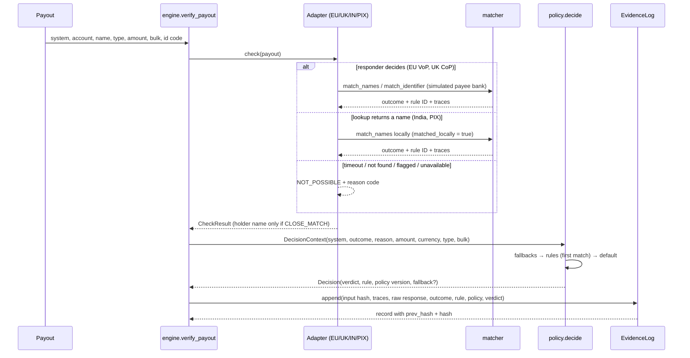
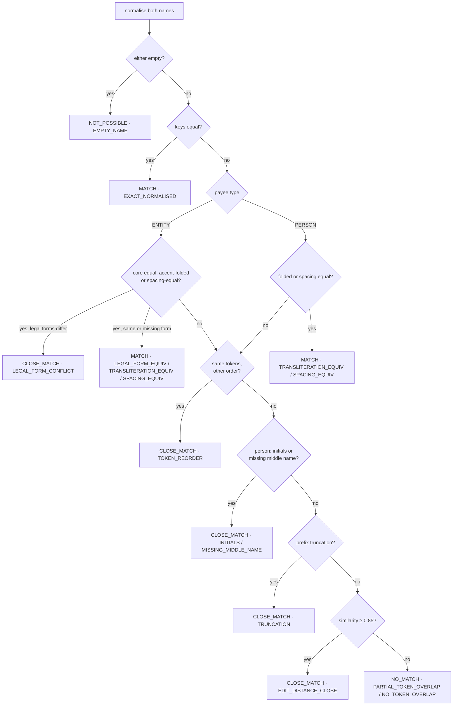

# Architecture

## Modules

| Module | Responsibility | Depends on |
|---|---|---|
| `models.py` | Pydantic types and enums: `Outcome`, `Payout`, `NormalisedName`, `MatchResult`, `CheckResult`, `DecisionContext`, `Decision`. | — |
| `normalize.py` | Traced, deterministic name normalisation; legal-form and honorific tables; `normalize_identifier`. | models |
| `matcher.py` | Reference matcher: ordered, named rules for people and entities; ID-code check with LEI check digits; Levenshtein. | models, normalize |
| `registry.py` | Load and validate the synthetic account registry. | models |
| `adapters/` | Simulated EU VoP, UK CoP, India name lookup and PIX key lookup, each mapped to `CheckResult`. | matcher, registry |
| `policy.py` | Versioned YAML policy, validation on load, pure `decide(context, policy)`. | models |
| `messages.py` | Payer-facing text per outcome. | models |
| `evidence.py` | Hash-chained evidence log, `verify()`, `replay()`, `render_diff()`. | models, policy |
| `engine.py` | `verify_payout`: adapter → context → policy → message → evidence. | adapters, policy, messages, evidence |
| `bulk.py` | CSV/JSONL input, aggregated counts, seeded synthetic payout generator. | engine |
| `corpus.py` | Load the labelled corpus, run the matcher, per-category report, gates. | matcher |
| `cli.py` | `verify`, `bulk`, `generate`, `corpus`, `replay`, `diff-policy`, `demo`. | all |

Nothing in `src/` opens a network connection. The only I/O is reading YAML, CSV or JSONL and writing reports or evidence when asked.

## One payout, end to end



## Matcher rule order



A MATCH reached only after an address was stripped from the name is downgraded to `CLOSE_MATCH · ADDRESS_IN_NAME`. The UK CoP simulator downgrades a MATCH on the wrong account type (personal vs business) to `CLOSE_MATCH · ACCOUNT_TYPE_MISMATCH`.

## Determinism

- `normalize`, `match_names`, `match_identifier` and `decide` are pure functions.
- Similarity is rounded to 4 decimal places, so evidence hashes are stable.
- The EU VoP adapter takes an injectable latency model. Tests simulate a 60-second responder without sleeping.
- The engine takes an injectable clock. The demo and tests use a fixed clock, so their evidence hashes are reproducible.
- Synthetic payouts come from a seeded `random.Random`.

## What a record looks like

One line of the evidence JSONL, abbreviated:

```json
{"seq":0,"at":"2026-10-10T09:00:00Z","payout_id":"DEMO-01",
 "input_hash":"…64 hex…","system":"EU_VOP",
 "context":{"system":"EU_VOP","outcome":"MATCH","reason_code":null,"amount":"2500",
            "currency":"EUR","payee_type":"ENTITY","bulk":false},
 "normalisation":{"requested":[…],"actual":[{"step":"transliterate","before":"Müller GmbH","after":"Mueller GmbH"},…]},
 "raw_response":{"status":"ANSWERED","checked":"name","result":"MATCH","responder_rule":"EXACT_NORMALISED",…},
 "outcome":"MATCH","reason_code":null,"rule_id":"EXACT_NORMALISED","matched_locally":false,
 "account_holder_name_shown":null,"policy_id":"payout-default","policy_version":"1.0.0",
 "policy_rule_id":"R02-match-proceed","verdict":"PROCEED","fallback_applied":null,
 "payer_message":"The name matches the account holder.","prev_hash":"000…0","hash":"…"}
```
